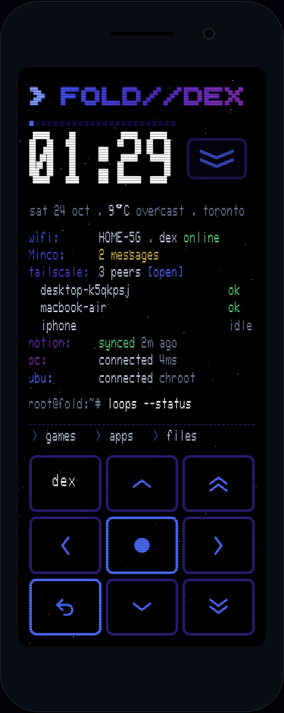
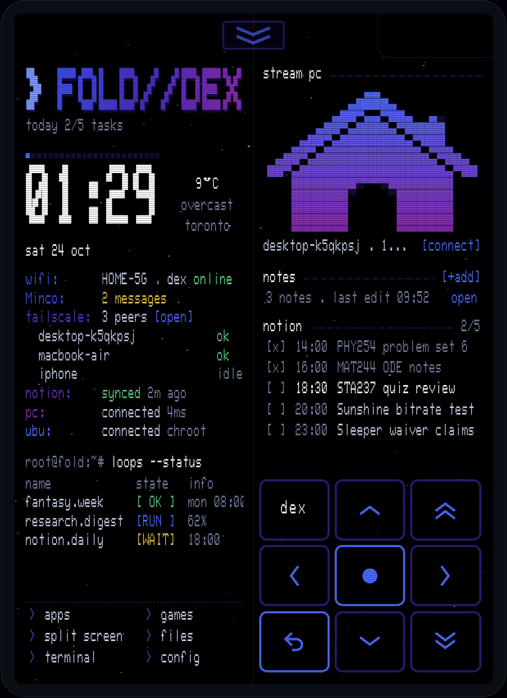

# FOLD//DEX

My old Galaxy Fold 1 turned into a little Linux cyberdeck. It's rooted, runs an Ubuntu 24.04 chroot, and has its own launcher (Fold Deck) that replaces the Samsung home screen on both the cover screen and the big inner one.

<p>
  
  
</p>

*Cover screen on the left, unfolded on the right. Those are screenshots of the browser preview, so the data is sample data.*

## The idea

One device that does the stuff I actually reach for:

- **Games**: PS1 and PSP through RetroArch/PPSSPP, plus Zelda through Ship of Harkinian, all in one games drawer
- **Schedule + notes**: my Notion tasks for the day, quick notes that sync to Notion
- **Connecting to my other stuff**: SSH into my PC and back into the phone over Tailscale, and Moonlight to stream the PC
- **dex**: a little assistant built into the launcher (Claude)
- A d-pad that's always on screen, so the whole thing works like a handheld

Look is a black terminal, WarGames Terminal font, dark blue/purple accents.

## How it's put together

The launcher is one HTML page running in a WebView inside a tiny Android app. The Java side (`MainActivity.java`) is just a bridge: battery, wifi, launching apps, running root shell commands, HTTP and speech. Everything you see is `ui/deck-source.html`.

| Folder | What's in it |
|---|---|
| `ui/` | The launcher. `deck-source.html` is the readable one, `index.html` is the same thing with the fonts inlined (that's what goes in the APK) |
| `android/` | Manifest, the Java bridge, icon, `build.sh` |
| `phone/` | Boot scripts: Termux:Boot runs `10-fold-deck`, which runs `ubuntu-boot.sh` to mount the chroot and start sshd |
| `scripts/` | Windows helpers for pushing games to the phone, EarthBound port build |
| `tools/` | Repack + sign an APK when only the UI changed |

Open `ui/index.html` in a browser to play with it. Press **O** to unfold, **R** to rotate.

## Building

UI-only change (most of the time): drop the new `index.html` into the last APK and re-sign.

```
python3 tools/pack.py FoldDeck-old.apk ui/index.html unsigned.apk
```

```
javac -cp apksig.jar tools/Sign.java -d tools && java -cp apksig.jar:tools Sign deck.jks <password> unsigned.apk FoldDeck.apk
```

Full build: `android/build.sh` (needs the Android SDK build-tools 35 + platform 34).

The signing key isn't in this repo on purpose. Updates only install over the old app if they're signed with the same key.

## Minco line

The `Minco:` line under wifi shows `no messages` or `x messages` for texts from Minco on my iPhone. iMessage can't run on Android, so the iPhone forwards them:

1. iPhone Shortcuts → Automation → Message → sender is Minco → Run Immediately
2. Action: Get Contents of URL, `POST https://ntfy.sh/<topic>`, body = Shortcut Input
3. On the Fold: config → *minco ntfy topic* → put the same topic in

It counts messages since you last tapped the line. Tapping it clears it (and opens the ntfy app if it's installed).

## Credits

Fonts: WarGames Terminal by Michael Walden (CC BY-NC-SA 4.0), BigBlue TerminalPlus by VileR (CC BY-SA 4.0).
